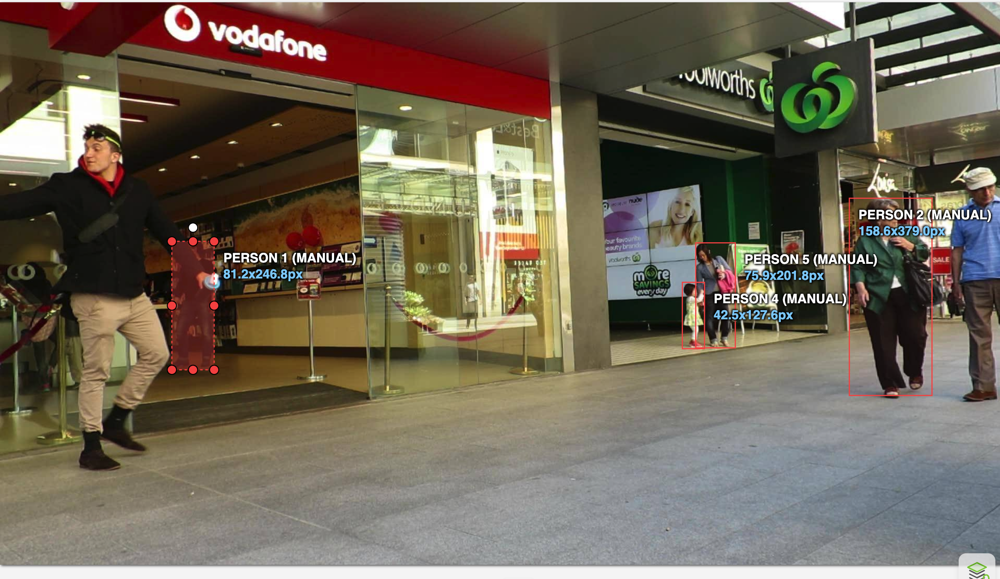
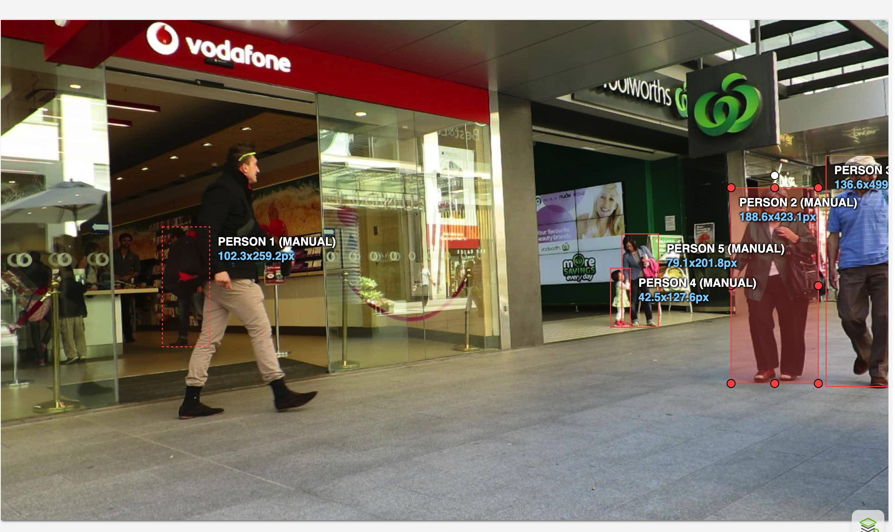
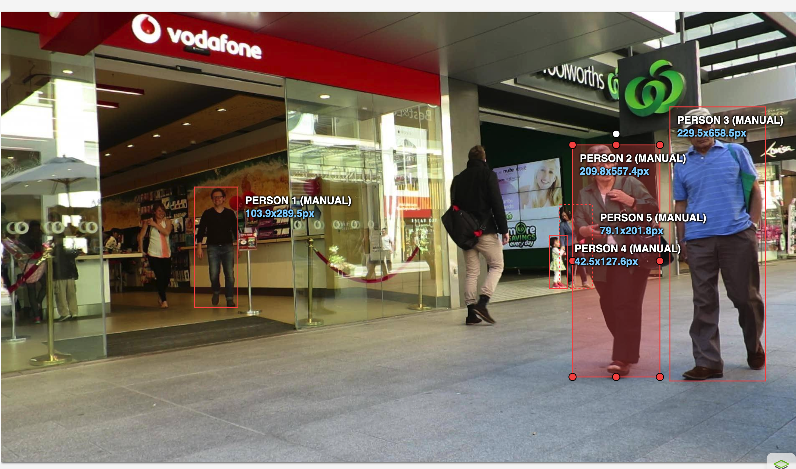

# Báo cáo cá nhân — LeVanTrungTinh-2A202603145

Đoạn video: MOT17-09, 150 frame (frame 0–149 theo CVAT), nguồn MOTChallenge,
giấy phép CC BY-NC-SA 3.0.

## 0. Thông tin học viên

- Họ tên: Lê Văn Trung Tính
- MSSV: 2A202603145
- Mã đề: B
- Email: 26ai.tinhlvt@vinuni.edu.vn
- Link repository: https://github.com/tinhne/K5_L2-DAY5-LeVanTrungTinh-2A202603145-MOTTracking
- Giờ bắt đầu: 16h00
- Giờ kết thúc: 13/11/2026 — 19h00

Đề B gồm các đối tượng P1, P19, P20, P21 và P22 theo bảng nhận diện. Trong
báo cáo này, năm track trong file xuất được đối chiếu theo thứ tự P1–P5 của
bảng nhận diện.

## 1. Xem trước đoạn video (CP0)

| Mã  | Frame xuất hiện | Frame cuối thấy được | Rẽ / dừng / đổi tốc độ ở frame | Bị che ở frame     | Ghi chú                            |
| --- | --------------: | -------------------: | ------------------------------ | ------------------ | ---------------------------------- |
| P1  |               0 |                  149 | Xem lại quanh 29–55            | 29–54; ngoài 39–48 | Track 1, có đoạn khuất và hiện lại |
| P2  |               0 |                  149 | Không ghi nhận riêng           | Không ghi nhận     | Track 2, có mặt đủ 150 frame       |
| P3  |               0 |                  148 | Không ghi nhận riêng           | Ngoài 110–139      | Track 3, hiện lại từ frame 140     |
| P4  |               0 |                  104 | Không ghi nhận riêng           | Không ghi nhận     | Track 4, kết thúc ở frame 104      |
| P5  |              40 |                  149 | Không ghi nhận riêng           | Không ghi nhận     | Track 5, xuất hiện từ frame 40     |

## 2. Keyframe và thời gian (CP1, CP4)

| Mã       | Số keyframe | Keyframe ở frame                                                                        | Số frame có mặt | Keyframe / 100 frame | Thời gian (phút) | Chỗ khó                        |
| -------- | ----------: | --------------------------------------------------------------------------------------- | --------------: | -------------------: | ---------------- | ------------------------------ |
| P1       |          21 | 0, 1, 10, 20, 29, 30, 49, 50, 55, 59, 60, 70, 80, 90, 100, 110, 120, 130, 139, 140, 149 |             140 |                 15.0 | Chưa ghi nhận    | Đoạn bị che và bật/tắt outside |
| P2       |          18 | 0, 10, 20, 30, 40, 49, 50, 59, 60, 70, 80, 90, 100, 110, 120, 130, 140, 149             |             150 |                 12.0 | Chưa ghi nhận    | Theo dõi đủ đoạn 0–149         |
| P3       |          12 | 0, 10, 20, 30, 40, 140, 149                                                             |             119 |                  5.0 | Chưa ghi nhận    | Đoạn outside 110–139           |
| P4       |           8 | 0, 10, 20, 30, 40, 50, 95, 100                                                          |             105 |                  7.6 | Chưa ghi nhận    | Kết thúc thấy được ở frame 104 |
| P5       |          12 | 40, 50, 60, 70, 80, 90, 100, 110, 120, 130, 140, 149                                    |             110 |                 10.9 | Chưa ghi nhận    | Bắt đầu từ frame 40            |
| **Tổng** |      **65** | —                                                                                       |         **624** |             **10.4** | —                | —                              |

Keyframe / 100 frame của cả bài = 65 ÷ 624 × 100 = **10.4**.

Đặt keyframe nhiều nhất ở P1 vì người này có đoạn bị che, cần keyframe trước
khi bị che, khi bật outside, khi hiện lại và khi thấy rõ trở lại.

## 3. Đoạn bị che (CP2)

Người bị che: **P1**

| Mốc                                      | Frame |
| ---------------------------------------- | ----: |
| Bắt đầu bị che một phần (bật `occluded`) |    29 |
| Mất hẳn (bật `outside`)                  |    39 |
| Hiện lại (tắt `outside`)                 |    49 |
| Thấy rõ trở lại (tắt `occluded`)         |    55 |

- Thời gian khuất hẳn: **10 frame (39–48) = 0,33 giây** ở 30 fps.
- Quyết định: **giữ cùng ID**.
- Lý do: đoạn khuất ngắn hơn nhiều so với ngưỡng 60 frame; track được giữ
  liên tục và P1 hiện lại đúng vùng, hướng và chuyển động trước khi khuất.

Ảnh chụp màn hình cần bổ sung nếu chưa lưu:





## 4. Tự review ID (CP3)

Đã kiểm tra hai lượt: lượt 1 theo từng người từ frame 149 về 0 và lượt 2
theo cảnh với bước nhảy 10 frame. Kết quả tự kiểm không phát hiện lỗi.

| Frame | Mã người | Loại lỗi | Mô tả một câu                                           | Phát hiện ở lượt | Đã sửa?       |
| ----: | -------- | -------- | ------------------------------------------------------- | ---------------- | ------------- |
|     — | P1–P5    | —        | Đã kiểm hai lượt, không phát hiện lỗi ID hoặc box thừa. | Lượt 1 và 2      | Không cần sửa |

| `id_switch` | `fragmentation` | `lost` | `merge` | `false_track` | `drift` | `flag` |
| ----------: | --------------: | -----: | ------: | ------------: | ------: | -----: |
|           0 |               0 |      0 |       0 |             0 |       0 |      0 |

Không có lỗi chỉ lượt 2 phát hiện; cả hai lượt đều không phát hiện lỗi.

## 5. File xuất và kết quả tự kiểm (CP4)

| Kiểm tra                                                     | Kết quả                                     |
| ------------------------------------------------------------ | ------------------------------------------- |
| Tên file MOT 1.1                                             | `src/exports/LeVanTrungTinh_mot.zip`        |
| Tên file CVAT for video 1.1                                  | `src/exports/LeVanTrungTinh_cvat_video.zip` |
| Số track ID khác nhau trong `gt/gt.txt` (phải là 5)          | 5 — đạt                                     |
| Frame `outside` không có dòng trong `gt/gt.txt` (đúng / sai) | Đúng                                        |
| Job đã completed trên CVAT máy cá nhân                       | Đã completed                                |

Kết quả `src/check_submission.py`:

```text
Số frame in theo CVAT (bắt đầu từ 0). Trong gt.txt, frame_id = frame CVAT + 1.

=== File MOT 1.1: LeVanTrungTinh_mot.zip ===
  Số track ID: 5   |   Tổng số box: 624
  [OK]        Đúng 5 track ID.

  Track | Frame có mặt | Số frame | Đoạn vắng (outside)
      1 |   0–149      |      140 | 39–48
      2 |   0–149      |      150 | -
      3 |   0–148      |      119 | 110–139
      4 |   0–104      |      105 | -
      5 |  40–149      |      110 | -

=== File CVAT for video 1.1: LeVanTrungTinh_cvat_video.zip ===
  Tổng: 65 keyframe / 624 frame có mặt = 10.4 keyframe / 100 frame
  [OK]        Đọc được 5 track từ annotations.xml.

=== Tóm tắt ===
  Lỗi: 0   |   Cảnh báo: 0
  Đạt.
```

## 6. Ba câu kết

1. Nếu làm lại, tôi sẽ giữ nhiều keyframe hơn quanh các điểm đổi hướng và
   đổi kích thước; riêng đoạn P1 sẽ tiếp tục đặt keyframe ngay trước và sau
   đoạn khuất để giảm sai lệch nội suy.

2. Trường hợp khó nhất là P1 trong đoạn 39–48. Tôi quyết định giữ cùng ID
   vì đoạn khuất chỉ 10 frame, nhỏ hơn ngưỡng 60 frame, và vị trí hiện lại
   phù hợp với hướng chuyển động trước đó.

3. Nếu xảy ra `id_switch`, hệ thống theo dõi có thể gán vận tốc của người
   này cho người khác, làm dự đoán đường đi sai. Lỗi này thường ảnh hưởng
   **IDF1** rõ hơn vì làm sai tính liên tục danh tính, đồng thời cũng có thể
   làm giảm MOTA nếu kéo theo các ghép sai hoặc box sai.

## 7. Tài liệu tham khảo và công cụ AI đã dùng

- MOT17-09 từ MOTChallenge.
- `docs/GUIDELINE.md`, `docs/CVAT_CHEATSHEET.md` và `CHECKPOINTS.md` của bài.
- CVAT local để gán nhãn và xuất hai định dạng.
- `src/check_submission.py` để tự kiểm định dạng, track, keyframe và cờ
  `occluded`/`outside`.
- AI assistant dùng để đọc kết quả tự kiểm và hỗ trợ trình bày báo cáo; các
  thông tin định lượng trong báo cáo lấy từ file xuất và kết quả script.

## Bonus

Đã thực hiện thử nghiệm B2 bằng file riêng
`src/exports/LeVanTrungTinh_bonus_b2.zip`. File thử nghiệm có 7 track và 816
box vì giữ thêm track phụ để so sánh, nên **không dùng thay cho hai file nộp
chính**. File nộp chính vẫn đạt 5 track, 0 lỗi và 0 cảnh báo.
